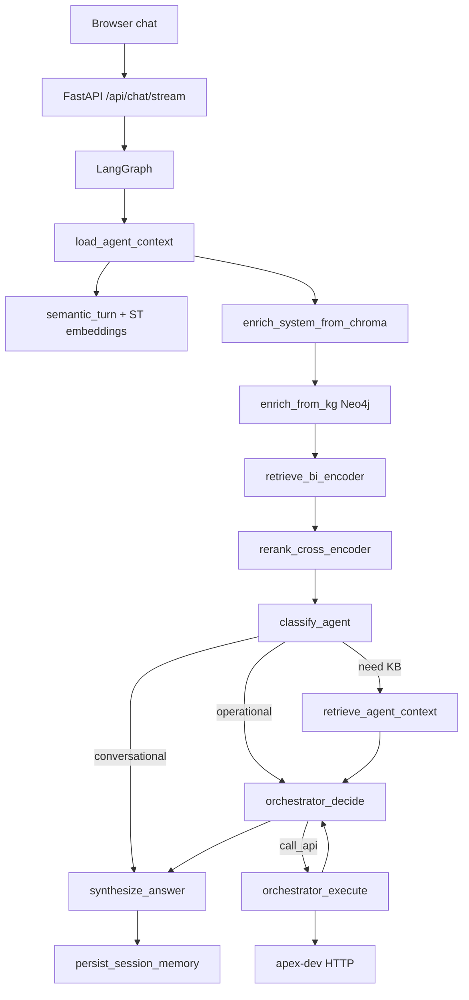

# Architecture: chat LLM + agent pipeline

The **instruct chat model** (recommended: **Qwen2.5-3B-Instruct** via **llama.cpp** on port **8000**) acts as router, planner, and narrator. Ground truth for ticketing data comes from **apex-dev HTTP APIs**, **Chroma** retrieval, and optionally **Neo4j** context — not from LLM weights alone.

See [CHAT_MODEL.md](./CHAT_MODEL.md) for GGUF selection and [SETUP.md](./SETUP.md) for required processes.

## Services and ports

| Port | Role |
|------|------|
| **8080** | FastAPI web UI + LangGraph `run_demo` |
| **8000** | llama.cpp **chat** (`POST /v1/chat/completions`) |
| **8081** | Embeddings HTTP (BGE-small) or in-process sentence-transformers |
| **8002** | ChromaDB (KB + session memory + intent routes) |
| **7474** | Neo4j Browser (optional KG) |
| **7687** | Neo4j Bolt |
| **HTTPS** | apex-dev APIs (Search, Admin, Events, Inventory, Marketing, Manifest, Reports) |

## End-to-end flow (one user message)

### What uses the chat LLM

| Step | LLM? | Output |
|------|------|--------|
| Semantic turn | No (BGE-small in-process) | Topic shift, conversational gate, trimmed history |
| Chroma enrich | No | Role hints, session turns (`CHROMA_SYSTEM_ENRICH_TOP_K`) |
| Neo4j enrich | No | Entity/context lines when `KG_NEO4J_ENABLED=true` |
| Classify | Yes (skipped for hello) | `intent` + `need_kb_retrieval` |
| Orchestrator | Yes | `call_api` / `finish`, intent, plan |
| Plan (per intent) | Often | JSON plan (`eventId`, `pageSize`, …) |
| Execute API | **No** | Real HTTP + JWT |
| Synthesize | Sometimes | Prose from JSON (**formatters preferred for lists**) |

### What uses embeddings (not chat)

- Chroma retrieval (KB, session hints, role hints)
- Intent semantic router (`intent_semantic.py`) — always in-process ST when enabled
- **Capability router** (`capability_routing.py`) — embeds API affordances from JSON + OpenAPI KB ([CAPABILITY_ROUTING.md](./CAPABILITY_ROUTING.md))
- Optional: `:8081` embed server for RAG when `RAG_EMBEDDING_BACKEND=http`

## One `chat_completion` call

Built in `apex_rag_demo/clients/llama.py`:

1. Merge **system** + semantic turn block + Chroma appendix  
2. Append trimmed **chat history** (user/assistant/tool summaries)  
3. Append current **user** task  
4. **Budget** via `prompt_budget.fit_messages_to_context` (char-based token *estimate*)  
5. POST JSON `messages` to llama.cpp  

The **tokenizer** runs only on the llama.cpp server for the loaded GGUF model.

## Ground truth vs hallucination risk

| Source | Trust |
|--------|--------|
| `api_payload` + `format_deterministic` + `ui_display` tables | High |
| `synthesize_apex_answer` (LLM + large JSON + history) | Lower — model may narrate or blend topics |

Recommended direction: **formatter-first** for read intents; LLM only for short rephrasing of extracted facts.

## TestRail / MFE catalog

- **`data/testrail_catalog.json`** — harvested from the **11 APEX MFEs** (TestRail / UI smoke / API `TESTS.md` only). Layout-only pilots stay unmapped; Chroma ingests **operational** rows (`chat_automatable` + API intent). Regenerate: `python scripts/build_testrail_catalog.py` (reads `~/Documents/axs/apex` by default).
- **`data/ai_harness_prompts.json`** — operator-style golden prompts + `expected_intent` for `scripts/e2e_ai_harness.py` (guard labels, no server) and `scripts/e2e_testrail_prompts.py` (live chat).
- **Chroma `apex_intent_routes`** — operator prompts + intent exemplars embedded for **pre-LLM** routing (`rag/intent_chroma.py`). Synced with `python -m apex_rag_demo.rag.sync_index --store chroma`. Stream UI shows **Semantic (pre-LLM)** before classify/orchestrator LLM; high-confidence routes skip classify LLM.
- Each entry: `testrail_id`, `mfe`, `assistant_intent`, `example_prompt`, `chat_automatable`.
- Loaded into KB (`testrail_catalog.catalog_kb_texts`) for Chroma after `sync_index`.
- **Implemented chat intents** from catalog mapping: search (orders, customers, events), marketing_events, inventory_zones (incl. best available on event), admin venues/users, event CRUD/publish. Fan **buy seat** stays `explain` (anti-hallucination). No MFE trivia routing.
- E2E sweep: `APEX_TEST_TOKEN=… python scripts/e2e_testrail_prompts.py` (limit via `TESTRAIL_E2E_LIMIT`).

## Related docs

- [SETUP.md](./SETUP.md) — `.env`, processes, bring-up  
- [EXTENSIONS.md](./EXTENSIONS.md) — declarative plugins, sandbox, checkpointer/store  
- [KG_NEO4J.md](./KG_NEO4J.md) — ontology, sync, runtime enrichment  
- [CONFIG.md](./CONFIG.md) — environment variables  
- [RAG_STACK.md](./RAG_STACK.md) — embeddings, Chroma, sync  
- [API_LINKS.md](./API_LINKS.md) — swagger URLs  
- [ROUTING_AND_MCP.md](./ROUTING_AND_MCP.md) — events vs venues  
